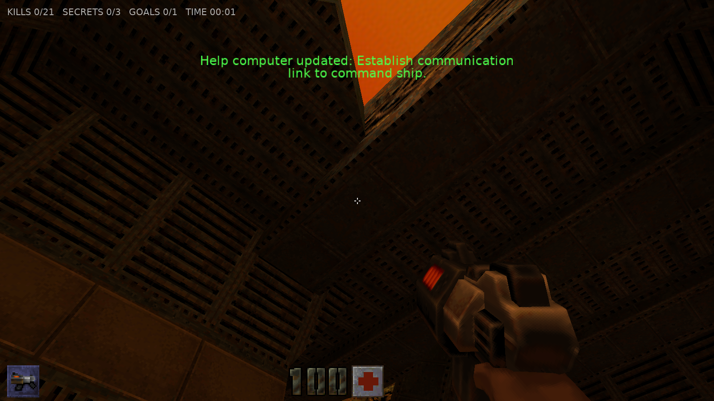
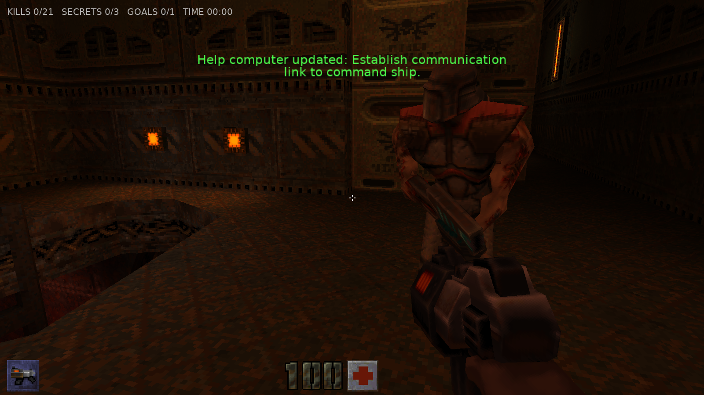
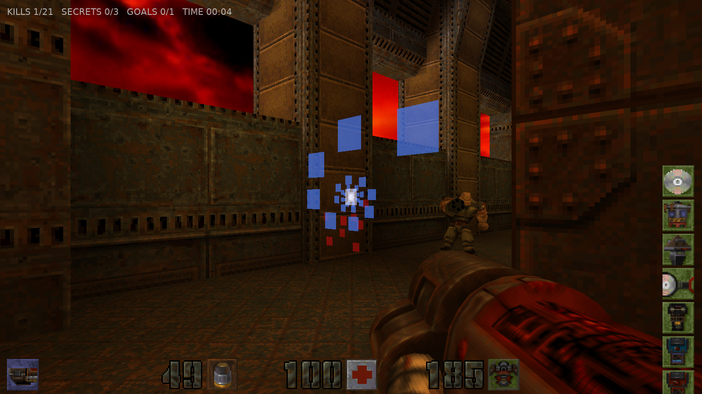
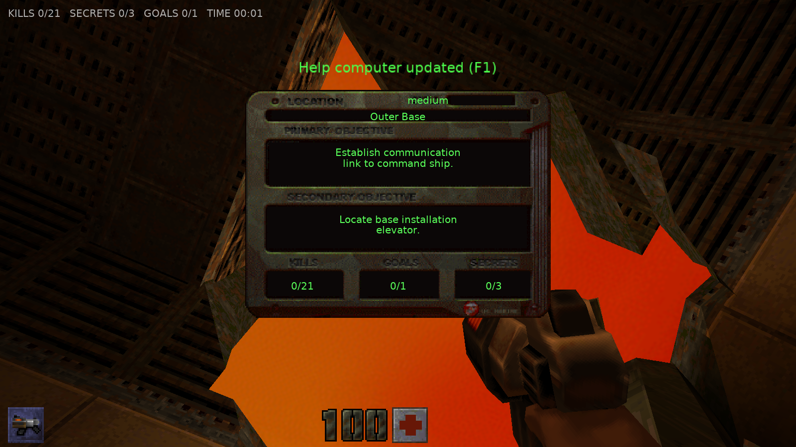
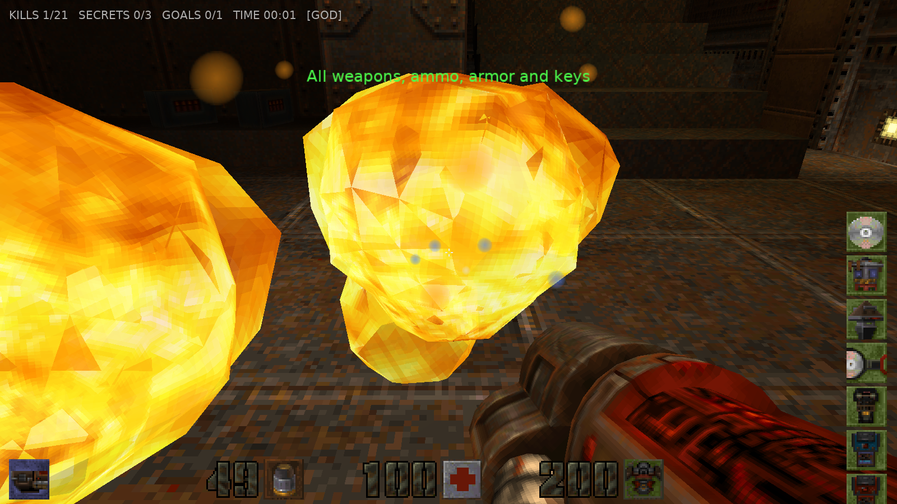
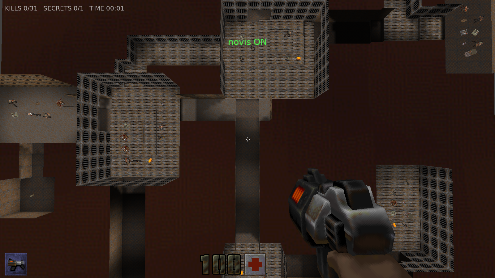
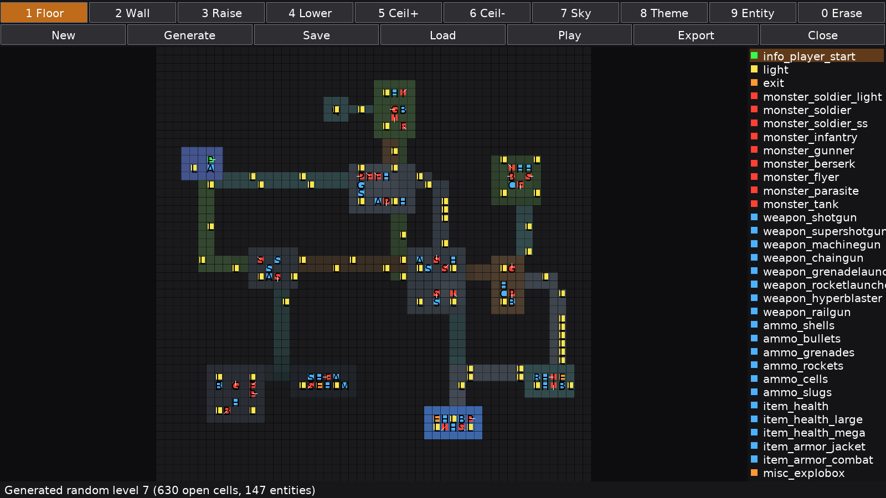
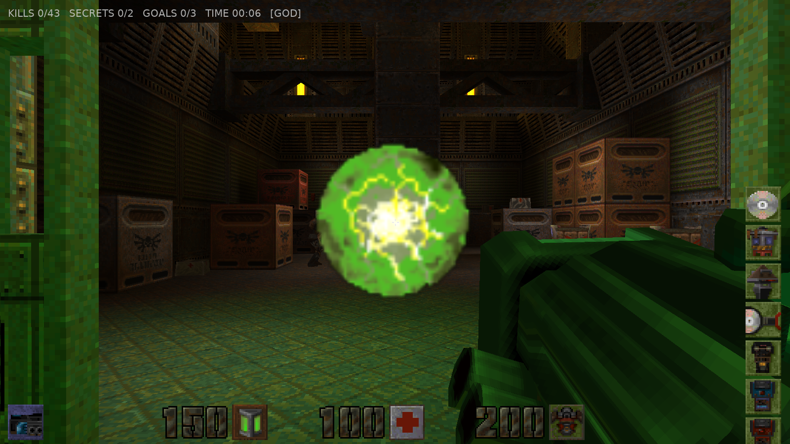
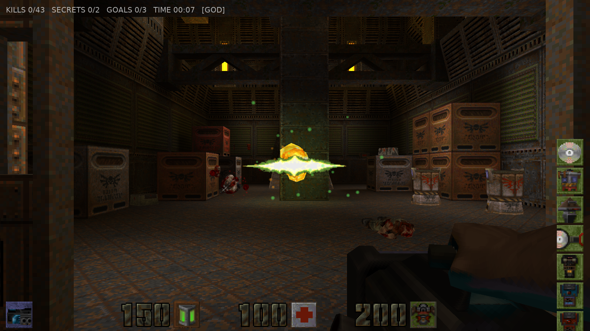

# Castle Quake 2

A port of **Quake 2** to the **Castle Game Engine** (Object Pascal / Free Pascal), the sibling of [mariuz/castle-quake1](https://github.com/mariuz/castle-quake1). It comes with the original **Quake 2 shareware demo** (`demo1`–`demo3`, the first three Outer Base levels), plays a full Quake 2 install or a mod, and makes **endless new levels** of its own.



- 🌐 **[Play in the browser](https://mariuz.github.io/castle-quake2/)**: nothing to install
- 📦 **[Download for Windows, Linux and Android](https://github.com/mariuz/castle-quake2/releases)** (latest: v0.26.0, see the [changelog](docs/CHANGELOG.md))
- 📚 **[Documentation](#documentation)**

---

## Why this port?

If you just want to play Quake 2 as well as possible, use **Quake II Remastered** (the official release, with new content) or a mature source port such as **Yamagi Quake II** (faithful, well tested) or **vkQuake2** (a Vulkan renderer). This port doesn't try to beat them at that: it can't yet play the full game end to end, and it has no multiplayer.

What it offers instead:

- **New levels without tools.** Every seed of *Random Level* is a new level built with Quake / Doom layout rules, and the in-game **level editor** lets you paint your own and play it straight away. Both are compiled into real Quake 2 maps, which you can export: they also play in Yamagi Quake II.
- **Play anywhere from one codebase**: in the browser, on Android (touch controls, gamepads), on Windows and Linux.
- **Mods**: Quake 2 mods and Quake II Remastered data load over the base game (`-game`). Call of the Void, the Quake 1 / 2 crossover, is in progress.
- **A readable Quake 2 to learn from.** Object Pascal on a general-purpose game engine, with [documentation](docs/ARCHITECTURE.md) that maps each Quake 2 system to the engine parts it uses. Quake 2 maps open in the Castle Game Engine's visual editor.
- **Tested by machine**: about 400 unit checks and dozens of scripted play sessions run on every change, with screenshot comparisons.

What it doesn't do (yet): multiplayer, the full retail game checked from start to finish, and measured performance on real graphics cards. The [roadmap](docs/ROADMAP.md) has the details.

## Highlights

- **Quake 2 as it plays**: all 10 weapons and hand grenades on Quake 2's weapon frames, the original player physics (pmove), monsters with Quake 2's sight, hearing and attack timing, doors, lifts, trains, triggers, secrets, skill levels, savegames, the help computer.
- **Quake 2 as it looks**: lightmaps with flickering and switchable lights, dynamic lights, skyboxes, warped water, animated textures, MD2 models with smooth animation, particles and gibs.
- **Random levels**: loops, secret walls you shoot, key hunts, ambushes, lifts and ladders, slopes, windows, round rooms, slime and lava, outdoor areas, flickering lights. [More](docs/LEVELS.md).
- **Level editor** inside the game: paint walls and floors, add doors, lifts, switches, key doors, secret doors, water, monsters and items, then press *Play*. [More](docs/LEVELS.md).
- **Mods and the remaster**: mod folders, `.pkz` archives, PNG / TGA textures, extended maps. [More](docs/MODDING.md).
- **Desktop, browser and Android**, with keyboard and mouse, gamepads (rebindable) and touch controls.
- **Castle Game Engine editor**: open maps in the visual editor, select entities, tune monsters and sounds without code. [More](docs/MODDING.md#working-in-the-castle-game-engine-editor).

The full feature list, with the engine parts each feature uses, is in [FEATURES.md](docs/FEATURES.md).

| | |
|---|---|
|  |  |
|  |  |
|  |  |
|  |  |

---

## Getting started

- **In the browser**: open <https://mariuz.github.io/castle-quake2/>.
- **On your computer**: download the Windows or Linux package from the [releases](https://github.com/mariuz/castle-quake2/releases), unpack it and run `castle-quake2`. The shareware demo is included.
- **On Android**: install the APK from the releases (`adb install castle-quake2-*.apk`, or open it on the phone). It is debug-signed and not yet tried on a real device.
- **With the full game**: point it at your Quake 2 folder: `castle-quake2 -basedir "C:\Games\Quake2"` (also finds Quake II Remastered's `rerelease` folder), then pick a map in *Map Warp* or start with `+map base1`.
- **With a mod**: add `-game <folder>`, e.g. `-game q1q2` for Call of the Void. See [MODDING.md](docs/MODDING.md).
- **New levels**: *Random Level* or *Level Editor* in the menu.

---

## Controls

| Key | Action |
| --- | --- |
| **W, A, S, D** / Arrows | Move / strafe |
| **Mouse** | Look |
| **Left Mouse / Ctrl** (hold) | Fire |
| **Space** / **C** | Jump / Crouch |
| **E** | Use (doors, buttons) |
| **1 .. 9, 0** / Mouse wheel | Select weapon (Blaster .. BFG10K) |
| **G** | Hand grenades |
| **F1** | Help computer (objectives, kills / goals / secrets) |
| **F6 / F9** | Quick save / quick load |
| **F12** | Screenshot |
| **~** | Console (`map`, `maps`, `save`, `load`, `god`, `give all`, `give quad`, `give invulnerability`, `give <item>` (e.g. `give power shield`), `powerarmor`, `noclip`, `notarget`, `kill`, `fps`, `markers`, `novis`, `skill`, `lightstyle`, `record <name>` / `stop`, `spawn <class> [key value]...`, `sky <name> [rotate [x y z]]`, `randmap [seed]`, `editor [command]`, `quit`, `help`) |
| **F8** (debug build) | CGE inspector: hierarchy and live properties |
| **Escape** | Menu: *Single Player* (choose Easy / Medium / Hard / Nightmare), *Map Warp*, *Options* (camera, mouse sensitivity, invert mouse, view bob, field of view, sound and music volume, *Controls* to rebind keys) |

| Other input | How |
| --- | --- |
| **Touch** (phones, tablets; `--touch` on desktop) | Left thumb anywhere on the left 40 % of the screen: move stick; drag on the right: look; buttons FIRE, JUMP, DUCK, USE, WPN (next weapon), MENU; in menus tap a row to select it, tap it again to activate it (or change its value: left half down, right half up); the Android back button is Escape |
| **Gamepad** | Left stick move, right stick look, right trigger fire, A jump, B / left trigger crouch, X use, Y hand grenades, bumpers / D-pad up-down weapons, Menu menu, View help computer; in menus D-pad / left stick, A select, B back. The buttons can be rebound in *Options → Controls → Gamepad Buttons* (or `padbind <action> <button>` in the console) |

The movement, jump, crouch, use, fire, grenade and help keys above are the defaults; rebind them in *Options → Controls*. Options are saved with CGE's `UserConfig` and restored on the next start.

Skill works like Quake 2: it picks which entities spawn (demo1 has 18 / 21 / 33 / 33 monsters on easy / medium / hard / nightmare), halves the damage you take on easy, makes monsters attack more often from hard on, and removes their pain flinches on nightmare. The `skill <0-3>` console command changes it for the next map; savegames remember it.

The level editor's controls are in [LEVELS.md](docs/LEVELS.md#editor-controls).

---

## Building from source

Prerequisites: [Castle Game Engine](https://castle-engine.io/) 7.0-alpha.3 or later (bundles FPC 3.2.2).

```powershell
$env:PATH = "C:\castle-engine\bin;C:\castle-engine\tools\contrib\fpc\bin;" + $env:PATH
castle-engine compile --mode=release
.\castle-quake2.exe
```

On Linux the same commands work with CGE's build tool on the `PATH`. `castle-engine package --target=android --mode=release` builds the APK (arm and aarch64, with the demo PAK inside); without `AndroidSigningProperties.txt` it is signed with a debug key. The unit tests are a separate project in `tests/`: see [TESTING.md](docs/TESTING.md).

---

## Documentation

| Document | What's in it |
| --- | --- |
| [FEATURES.md](docs/FEATURES.md) | Every feature, with the Castle Game Engine parts it uses |
| [LEVELS.md](docs/LEVELS.md) | Random levels, the level editor (controls, commands), exporting levels to other Quake 2 engines |
| [MODDING.md](docs/MODDING.md) | Game data and load order, mods and Quake II Remastered data, Call of the Void, working in the CGE editor |
| [TESTING.md](docs/TESTING.md) | Unit tests, the map compatibility report, command line, demo scripts, recording a playthrough as a test |
| [ARCHITECTURE.md](docs/ARCHITECTURE.md) | How it works: data flow, BSP, lightmaps, models, sound, game logic, the level compiler, CGE editor integration |
| [ROADMAP.md](docs/ROADMAP.md) | Comparison with Quake 2, what's done, what's next |
| [CHANGELOG.md](docs/CHANGELOG.md) | What changed in each release |
| [CLAUDE.md](CLAUDE.md) | Working notes for contributors (people and AI agents): conventions, where things live, how to test |

---

## License

- Code: MIT License (the same as mariuz/castle-quake1). This covers this project's own code only.
- Castle Game Engine, which the game is built with, is not MIT: its units (the ones linked into the game) are under the LGPL with a static linking exception, like the FPC run-time library. That exception means a game made with it can use any license, open source or proprietary, MIT included. See <https://castle-engine.io/license>.
- `data/paks/quake2_demo.pak` is the unmodified Quake 2 demo data © id Software, redistributed electronically free of charge under the id Software demo license in `data/paks/QUAKE2_DEMO_LICENSE.txt`, which must accompany it.
- Quake is a registered trademark of id Software / ZeniMax Media.
