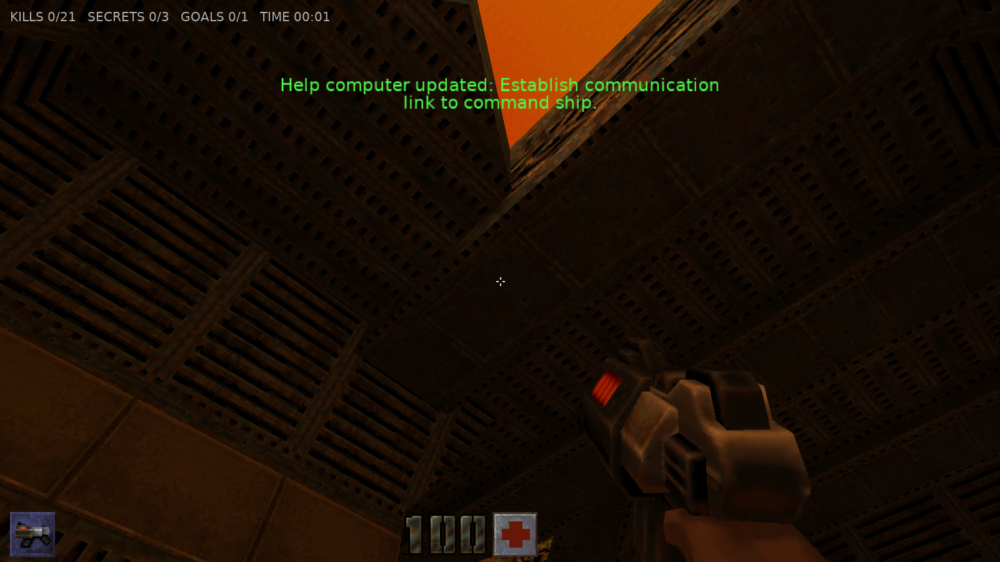
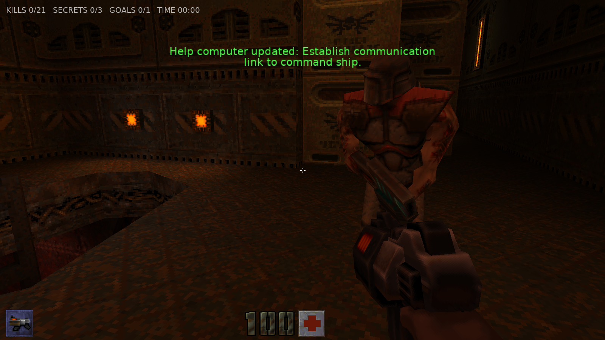
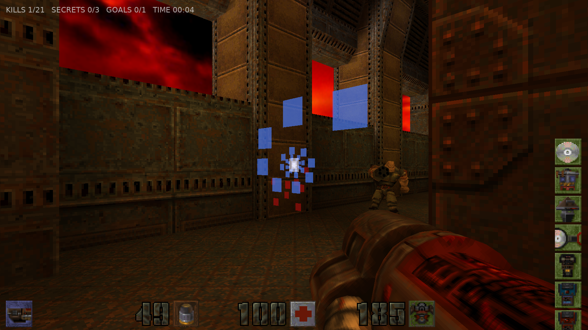
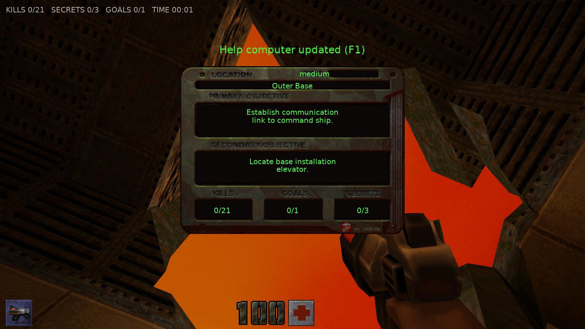
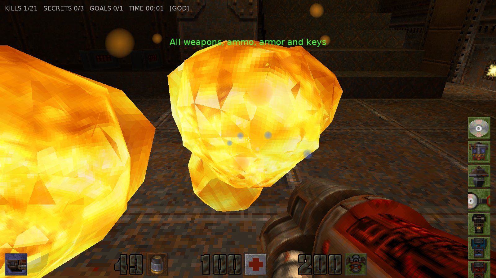

# Castle Quake 2

A port of **Quake 2** to the **Castle Game Engine** (Object Pascal / Free Pascal), the sibling of [mariuz/castle-quake1](https://github.com/mariuz/castle-quake1). Bundled with the original **Quake 2 shareware demo** data (`demo1`–`demo3`, the first three Outer Base levels), and able to load a full Quake 2 install (`baseq2/pak*.pak`).



- 📖 **[Architecture & Engine Mapping](docs/ARCHITECTURE.md)**
- 🗺️ **[Quake 2 Comparison & Roadmap](docs/ROADMAP.md)**

---

## Features (and the Castle Game Engine parts they use)

- **Quake 2 BSP (IBSP v38) world geometry**
  - All 19 lumps parsed; faces batched per texture + surface flags into X3D `TIndexedTriangleSetNode`s loaded into `TCastleScene` with `PreciseCollisions` for walking and ray casts.
  - **WAL wall textures** decoded with the `pics/colormap.pcx` palette and served through the `quaketex:` URL protocol.
  - **Baked RGB lightmaps** packed into one atlas per model and applied with `TMultiTextureNode` (`MODULATE` + `MODULATE2X`), like Quake 2's GL renderer.
  - Surface flags: `SURF_SKY` (invisible but solid), `SURF_NODRAW`, `SURF_WARP`, `SURF_TRANS33/66` (blended), `SURF_FLOWING` (scrolling `TTextureTransformNode`).
  - **Animated textures** following the WAL `animname` chains at 2 frames/second.
  - **Light styles**: flickering, pulsing and switchable lights. Faces lit by animated styles live in a separate lightmap atlas that is recomposed from their up to 4 style layers (10 Hz, only when a style changes) and re-uploaded; `light` entities with a `targetname` switch on/off, `target_lightramp` fades them.
- **Skybox** from `env/<sky>{rt,lf,up,dn,bk,ft}.tga|pcx` via `TCastleBackground`.
- **MD2 models** (IDP2 v8): monsters, items, weapons, projectiles and the first-person view weapon, with **interpolated frame animation**, PCX skins (index 255 transparent) and per-model tint sampled from the lightmaps below them (Quake 2's `R_LightPoint`, done by walking the BSP nodes).
- **Brush entities** as `TCastleTransform`s: `func_door`, `func_door_rotating`, `func_plat`, `func_button`, `func_rotating`, `func_train` (follows `path_corner`s), `func_wall`, `func_explosive` (shootable, chain reactions).
- **Quake 2 entity logic**: `target` / `targetname` chains (`G_UseTargets`), `trigger_multiple/once/relay/counter/key/hurt/always`, `delay`, `target_changelevel` (with `map$spawnpoint`), `target_secret/goal/help/speaker/explosion`, `misc_teleporter`, messages and the help-computer objectives.
- **All 10 weapons**: Blaster, Shotgun, Super Shotgun, Machinegun, Chaingun, Grenade Launcher (bouncing grenades), Rocket Launcher (splash damage), HyperBlaster, Railgun (piercing, spiral trail), BFG10K. Hitscan uses `WorldRayCast` against the scene, so shots stop at walls and hit the exact monster mesh.
- **Items**: health, armor (jacket/combat/body with Quake 2 protection and salvage rules, shards), ammo, quad damage, invulnerability, adrenaline, bandolier, ammo pack, keys (data CD, power cube, pyramid, spinner, pass, blue/red key, commander's head, airstrike marker).
- **Monsters** (19 types defined; the demo has soldiers, enforcers, gunners, berserkers, flyers, parasites and tanks): sight via line-of-sight checks, chase with wall sliding (`TCastleTransform.Move`), floor following, melee / hitscan / blaster / rocket / grenade / railgun attacks, pain and death animations, gibbing into flying gib models; monsters detour around obstacles and won't walk off ledges; monster projectiles can hurt other monsters.
- **View weapon in its own transparent viewport** (`WeaponViewport`, cleared depth), so it never clips into walls.
- **Player physics ported from Quake 2's pmove** (`TQuakePlayerMovement`, a behavior on the camera): friction 6, accelerate 10, air control 1, gravity 800, jump 270, 18-unit steps, crouch (eye 46 → 22, speed 100), falling damage and jump pads (`trigger_push`). Tunables are published, so they can be tweaked in the editor; `Active = false` falls back to `TCastleWalkNavigation` movement. Plus noclip, damage with armor absorption, death and level restart.
- **HUD** drawn with the original `pics/*.pcx` big numbers, ammo/health/armor/weapon/key icons and crosshair (`TDrawableImage`), pickup notices and damage / quad / invulnerability screen blends.
- **Spatial audio** from the PAK's WAVs via `TCastleSoundSource`, with Quake 2's distance attenuation mapped to OpenAL's linear model; **ambient `target_speaker` loops** (80–90 per demo map) and triggered sounds; optional CD-music replacement as `data/music/trackNN.ogg`.
- **Props and effects**: exploding barrels (`misc_explobox`, chain reactions), waving banners, corpses, the satellite dish, flying Strogg ships along their `path_corner`s, `func_timer`, `target_splash` sparks, `target_laser` beams, and Quake 2's animated, skin-fading explosion model.
- **Help computer (F1)** with the original `help.pcx`, level name, primary / secondary objectives and kills / goals / secrets, and an **intermission** at `info_player_intermission` before the next unit loads.
- **Billboard particles** (`TBillboardNode`, soft round sprites): bullet impacts, blood, blaster sparks, splashes, rail trails, BFG blasts, teleport fountains.
- Drop-down **console**, **menu** with the map list read from the loaded PAKs, and a headless **autotest / demo-script harness**.

| | |
|---|---|
|  |  |
|  |  |

---

## Working in the Castle Game Engine editor

The project follows the structure of CGE's own templates (`3d_fps_game`) and the `examples/advanced_editor/custom_component` sample:

- **Views are designed, not hard-coded.** `TViewPlay` and `TViewMenu` load `data/gameviewplay.castle-user-interface` and `data/gameviewmenu.castle-user-interface` (`DesignUrl`); the viewport, camera (90° horizontal FOV), `TCastleWalkNavigation` (Quake 2 eye height 46, step 18, speed 300), `TCastleBackground`, HUD, console, menu and FPS label are published fields you can select and tweak in the editor.
- **Custom components** (`editor_units` in `CastleEngineManifest.xml`): **Quake 2 Map** (`TQuakeMap`), **Quake 2 HUD**, **Quake 2 Console**, **Quake 2 Menu**. Open the project in the editor and use *Project → Restart Editor (With Custom Components)*.
- **`TQuakePlayerMovement`** is a behavior of the camera in the play design: select *Camera → PlayerMovement* to tune run speed, jump, gravity, step size or to watch `OnGround` / `Crouched` live.
- **`TQuakeMap`** is a `TCastleTransform`: set `PakUrl` (default `castle-data:/paks/quake2_demo.pak`) and `MapName` (`demo1`, `demo2`, `demo3`, or `base1`... with a full PAK) and the level is built right in the editor viewport. Turn on `PreviewEntities` to see items and monsters as static models. Read-only `SkyName`, `EntityCount` and `FaceCount` show map info in the inspector. The game reuses this component: `TQuakeWorld` adds live entities on top of it.
- **Behaviors with published state.** Monsters (`TQuakeMonster`), items (`TQuakePickup`) and brush entities (`TQuakeMover`) are `TCastleBehavior`s attached to named transforms such as `Monster007_monster_soldier`, `Item012_weapon_shotgun` or `Mover19_func_door`. In a debug build (`castle-engine compile --mode=debug`) press **F8** to open the CGE inspector and watch `MonsterState`, `HitPoints`, `IsAlerted`, `MoverState`, `MoveProgress` and more change live.

---

## Controls

| Key | Action |
| --- | --- |
| **W, A, S, D** / Arrows | Move / strafe |
| **Mouse** | Look |
| **Left Mouse / Ctrl** (hold) | Fire |
| **Space** / **C** | Jump / Crouch |
| **E** | Use (doors, buttons) |
| **1 .. 9, 0** / Mouse wheel | Select weapon (Blaster .. BFG10K) |
| **F1** | Help computer (objectives, kills / goals / secrets) |
| **F12** | Screenshot |
| **~** | Console (`map`, `maps`, `god`, `give all`, `noclip`, `kill`, `fps`, `lightstyle`, `quit`, `help`) |
| **F8** (debug build) | CGE inspector: hierarchy and live properties |
| **Escape** | Menu |

---

## Building and Running

Prerequisites: [Castle Game Engine](https://castle-engine.io/) 7.0-alpha.3 or later (bundles FPC 3.2.2).

```powershell
$env:PATH = "C:\castle-engine\bin;C:\castle-engine\tools\contrib\fpc\bin;" + $env:PATH
castle-engine compile --mode=release
.\castle-quake2.exe
```

### Game data

PAKs are loaded in this order (later ones override earlier ones):

1. `data/paks/quake2_demo.pak` — the bundled shareware demo (`pak0.pak` from `q2-314-demo-x86.exe`).
2. `baseq2/pak0.pak`, `pak1.pak`, ... next to the executable — a full Quake 2 install.
3. `-basedir <quake2 dir>` (loads `<dir>/baseq2/pak*.pak`) and `-pak <file>`.

### Command line

```powershell
.\castle-quake2.exe +map demo2                 # start on a map ("base1" with the full game)
.\castle-quake2.exe -basedir "C:\Games\Quake2" # use a full Quake 2 install
.\castle-quake2.exe -gamma 1.0                 # original lightmap brightness (default 1.2)
.\castle-quake2.exe --autotest demo1 shot --demo "W:1,S,K,C:9,N:3,X,W:0.2,S,Q"
```

Demo script actions (comma separated): `W:sec` wait, `S` screenshot, `X` fire, `H` toggle hold-fire, `U` use, `C:slot` weapon, `K` give all, `Y` god, `A:deg` yaw, `T:deg` turn, `P:deg` pitch, `M:units` move, `N:i` / `I:i` / `D:i` / `R:i` stand near monster / item / brush entity / prop number i, `F` toggle the help computer, `G:x y z` go to Quake coordinates, `GO:forward side seconds` hold movement keys, `J` jump, `E:targetname` fire targets, `O:command` run a console command (e.g. `O:kill`), `V` log mover, prop and laser states, `L:map` load map, `Q` quit.

---

## License

- Code: MIT License (matching Castle Game Engine and mariuz/castle-quake1).
- `data/paks/quake2_demo.pak` is the unmodified Quake 2 demo data © id Software, redistributed electronically free of charge under the id Software demo license in `data/paks/QUAKE2_DEMO_LICENSE.txt`, which must accompany it.
- Quake is a registered trademark of id Software / ZeniMax Media.
